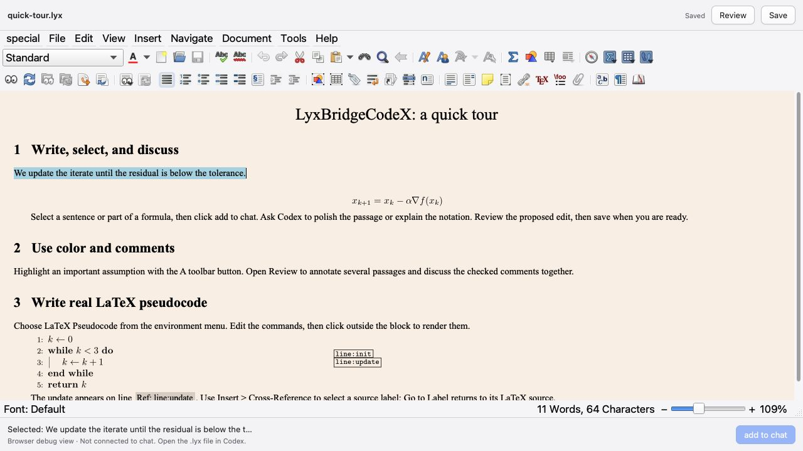
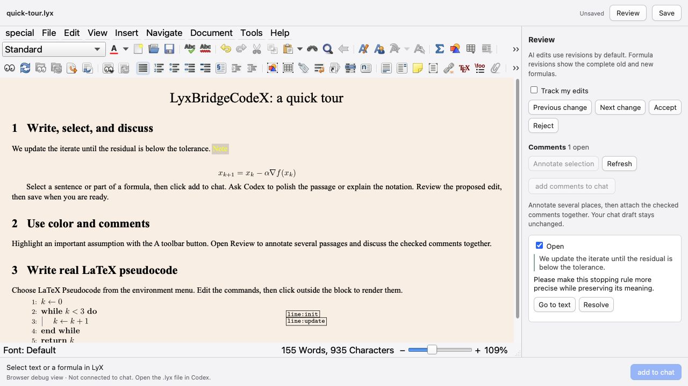
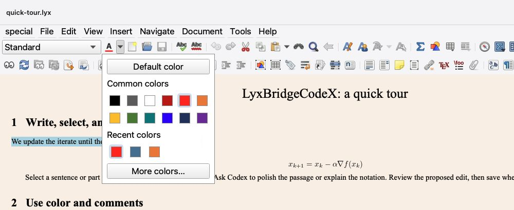
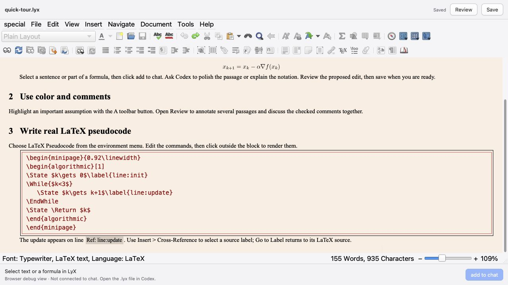
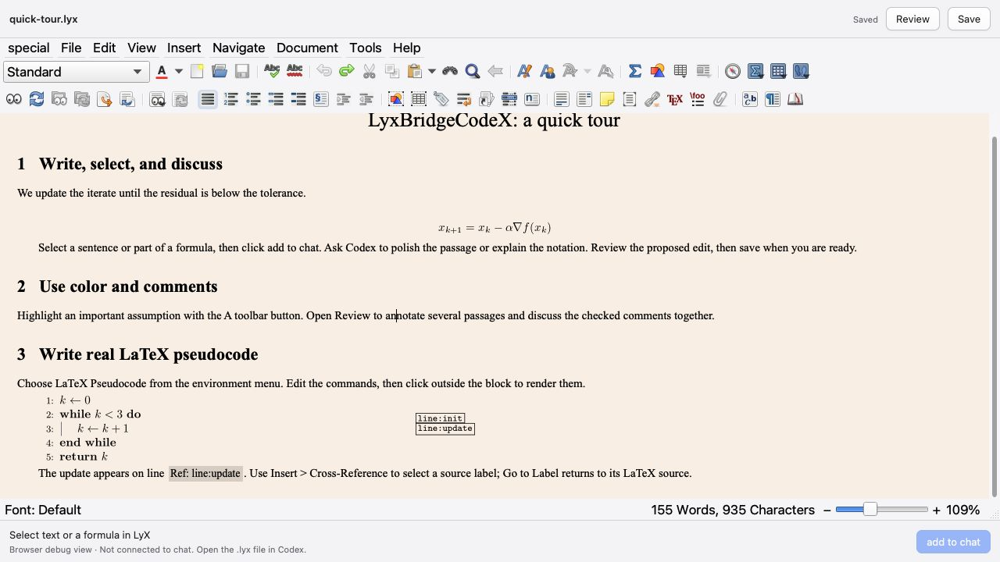
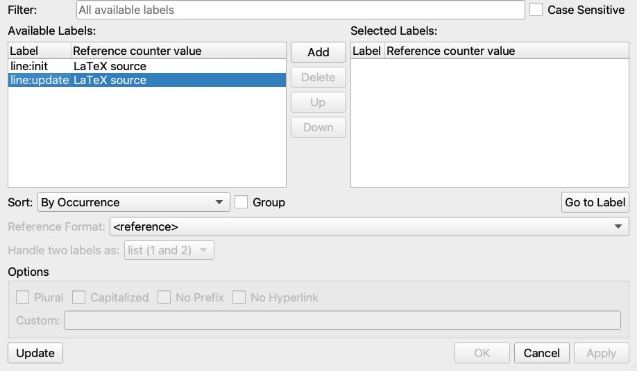

# LyxBridgeCodeX

Native LyX editing inside Codex, with editable formulas and document context sharing.

**v0.3.0 is an experimental source overlay for LyX 2.5.3, plus a Codex plugin.** It supplements official LyX source with a native editing bridge and presents that engine in a Codex side panel. This repository does not vendor the full LyX source or distribute a compiled application. Build the engine locally; this is not a standalone installer or a signed macOS application.

## A visual quick start

After [building and installing](#build-and-install), try [demo/quick-tour.lyx](demo/quick-tour.lyx):

1. **Open and edit.** Ask Codex to open the file in the native LyX editor. Write text, edit formulas, and choose paragraph environments from the toolbar.
2. **Select and discuss.** Select a passage or part of a formula, click **add to chat**, then send a request such as “Polish this sentence without changing its meaning.” Attaching a selection does not send a message.
3. **Review and save.** Inspect proposed edits in **Review**, accept or reject changes, and click **Save** when you want to write the document to disk.

The screenshots use this synthetic document in an isolated **local debugging view**. Its chat buttons are inactive; in Codex, check for **Connected to this chat** before attaching a selection. No personal documents, chat history, or account details are used.



*Text and formulas stay in LyX's native editing model. The selected sentence is the context for your next request.*

<details>
<summary>Annotate several passages before sending a request</summary>

Open **Review**, select a passage, and choose **Annotate selection**. Add a comment and repeat elsewhere. In Codex, check the comments you want to discuss and click **add comments to chat**, then send your request normally. The screenshot shows one example comment; it is stored as a native LyX note and is omitted from PDF output.



See [revisions and comments](docs/native-review.md) for tracked edits, multiple comments, and navigation.

</details>

## Features

- Edit text and formulas using LyX's own document model, rendering, menus, and undo history.
- Keep familiar keyboard shortcuts, including formula entry and undo.
- Create native LyX recovery snapshots every minute while there are unsaved changes. Snapshots use `#filename.lyx#`; reopening a file with a newer snapshot lets you load the backup, load the original, or cancel in the side panel. Use **Save** to write the main `.lyx` file.
- Choose paragraph environments in a list that fits the editor panel; scroll to all entries, including Standard, and confirm with Enter.
- Open native menus within the editor panel, with scrolling for long menus and working submenus in narrow panels.
- Copy and paste native LyX content while retaining editable formulas.
- Select text or a formula and click **add to chat** to attach context to the next message. The attachment shows the filename and selected passage once, with only the required edit target in structured metadata. It inserts no text into the composer and does not send a message.
- Ask Codex to polish the attached passage directly. The saved selection survives cursor movement, checks for intervening document changes, and applies as one undoable edit without saving.
- Review AI edits as native insertions/deletions and accept or reject them. Formula revisions keep complete editable old and new formulas.
- Annotate several passages in **Review**, then attach the checked comments together with **add comments to chat**. Comments are native LyX notes and survive Save and reopening.

The interface is English. Document language is independent of interface language. Each selection or comment-batch update replaces the previous context for that panel. To share multiple locations together, use a checked comment batch. See [revisions and comments](docs/native-review.md).

## Tested versions

| Component | Verified version |
| --- | --- |
| **Codex desktop host** | **26.1016.51333 (build 21161)** |
| Codex CLI used for plugin installation | 0.163.0-alpha.11 |
| macOS / architecture | 26.7.1 / Apple Silicon arm64 |
| LyX source / format | 2.5.3 / format 643; imports 2.4 format 620 |
| Qt development libraries | 5.15.2 |
| Node.js used locally | 23.11.0 |

These are tested versions, not a guarantee for every earlier or later Codex release. The desktop host must support plugin file entry points, MCP Apps, and OpenAI model-context extensions. CLI-only use does not provide the side-panel editor. Windows, Linux, and Intel macOS native editing have not been verified. See [compatibility and limitations](docs/compatibility.md).

## Build and install

Prerequisites: the Codex desktop app and CLI, Node.js 22 or newer with npm, Git, CMake, a C++ compiler (Xcode Command Line Tools on macOS), Python 3, and a complete Qt **5.15** development installation including its matching QtGui private/QPA headers (`Qt5::GuiPrivate`). The native CMake build also needs its usual LyX dependencies, including zlib, iconv, and Hunspell development files. A TeX distribution is needed for LyX PDF compilation/export.

Clone the repository. Packaged releases are currently on hold while testing continues:

```sh
git clone https://github.com/zhenweilin/LyxBridgeCodeX.git
cd LyxBridgeCodeX
npm ci
npm run build
```

To use your own upstream source checkout, first obtain the exact supported revision, then point the build at it:

```sh
git clone --branch 2.5.3 --depth 1 https://codeberg.org/LyX-org/lyx.git ../lyx-2.5.3
LYX_SOURCE_DIR="$(cd ../lyx-2.5.3 && pwd)" npm run build:native
```

The script validates commit `b6a54136e3fb519bfc25e32431801a6cf6992b3a` before patching. Use a dedicated Git checkout; other revisions and source archives without Git metadata are not accepted. It copies the bridge files and applies small, repeatable edits to the upstream build and Qt frontend. Build output stays under this repository's ignored `.native/` directory. See [the overlay contract](docs/overlay.md).

For convenience, omit `LYX_SOURCE_DIR` to download that checkout automatically. If Qt 5.15's `qmake` is on `PATH`, the build detects its installation prefix:

```sh
npm run build:native
```

Otherwise provide the prefix explicitly:

```sh
LYX_QT_PREFIX=/path/to/qt-5.15 npm run build:native
```

Both paths apply the same overlay and do not replace your desktop LyX installation. You may combine `LYX_SOURCE_DIR` and `LYX_QT_PREFIX` in one command.

The 2.5.3 source and executable live in versioned directories under `.native/`. Builds activate the new engine for newly opened document sessions; existing sessions continue running. To test before activation, use `LYX_NATIVE_ACTIVATE=0 npm run build:native` and select the resulting binary/library with `LYX_CODEX_BINARY` and `LYX_CODEX_LIBRARY`. See [upgrade details](docs/overlay.md). Opening a 2.4 document leaves its disk file unchanged; saving in 2.5.3 writes format 643.

Generate this checkout's local plugin configuration and install it:

```sh
npm run configure
codex plugin marketplace add "$PWD"
codex plugin add lyx-preview@lyxbridgecodex
```

`lyx-preview` is the retained internal plugin identifier. The display name is **LyxBridgeCodeX**. Configuration records the current Node executable and checkout path in an ignored `.mcp.json`. Keep this checkout in place; after moving it or changing Node installations, rerun configuration and plugin installation. The GitHub repository is a source distribution, not a ready-to-run remote marketplace installation.

Each checkout uses its own local broker on an available loopback port. A fresh clone can be installed while an older checkout still has open documents; those existing native processes retain their edits until you save and close them.

Open `demo/demo.lyx` in Codex, or ask Codex to open a local `.lyx` file through the plugin. The footer should say **Connected to this chat**. Select content and use **add to chat**, then type your request in Codex and submit it normally. Save in LyX when you want changes written to disk. `npm run editor` opens a local debugging view without chat integration.

With the updated native engine, **add to chat** captures a compact edit target. You can move the cursor afterward; Codex can replace that exact passage in one tool call without reading the whole document. A changed document requires a fresh selection. Targets last 30 minutes, with the latest 32 retained per native process. An identical retry returns the original receipt instead of applying twice. Older running engines keep the legacy selection workflow until restarted after resolving unsaved work. See [selection editing](docs/editor-ux.md#selection-editing).

For a connection problem, **Retry** checks the existing session. **Reopen editor** appears only after the native process is confirmed to have exited; it uses the last verified file path, including Save As, and preserves LyX's recovery choice. Queued edits are not replayed. Earlier chat selections remain historical snapshots and your draft stays unchanged; select content again to update the context. Broker loss alone cannot confirm that its editors exited, and neither ordinary editor requests nor Reopen editor starts a replacement broker. Missing initial file context shows **Waiting for file**; startup errors stay visible until resolved. See [recovery behavior and limits](docs/editor-ux.md).

If Codex has not loaded a newly installed plugin, save your work and restart the desktop app. Display the target chat in the main Codex window when opening a file there. An opening tool's `queued` acknowledgement does not confirm whether the side panel appeared; verify the visible editor and its connection footer. Merely reopening the debugging browser does not connect it to chat. Existing native engines can retain older capabilities; resolve unsaved edits before closing or replacing them.

Updating a running source checkout also requires attention to its separate background services: a rebuilt panel can load while an older MCP service or broker is still running. Plugin reinstallation or a Codex restart does not by itself prove that every layer updated. See [updating a running checkout](docs/compatibility.md#updating-a-running-checkout) before closing sessions that may contain unsaved work.

## Font colors

The native toolbar has an **A ▾** button next to the environment dropdown. Select text or part of a formula, open the arrow, and choose a swatch. Clicking **A** reapplies the last color. The palette includes common colors, six recent colors, **More colors…** (including an HTML/hex field), and **Default color**. Use the arrow keys to move between swatches, Enter to apply, and Esc or an outside click to dismiss. Opening the palette retains the document selection.



Colors use native LyX formatting and remain editable, undoable, and portable to PDF. Custom definitions and the formatting change undo together. Default color preserves other font properties. For math, select within one cell; recoloring replaces selected color wrappers while preserving the formula. Inside raw LaTeX/ERT, use LaTeX color commands instead; the toolbar is disabled there. Open a fresh native editor session after rebuilding to load the toolbar.

## LaTeX pseudocode

Choose **LaTeX Pseudocode** from the environment dropdown and press Enter. Edit the literal LaTeX source, then click outside the block or choose **Render LaTeX Pseudocode**. The native preview uses the same source as PDF export. Click the preview and its LaTeX box to edit again.

**Edit the source:** paired commands define the loop and its indentation.



**Click outside to render:** LyX displays the compiled pseudocode with line numbers. Small label markers are editor navigation aids; they do not appear in the PDF.



The dropdown includes While, For, For All, If/Else, Repeat/Until, Function, Procedure, State, Return, Comment and Input/Output templates. Inside a source block they insert commands at the caret; outside they create a complete block. LaTeX controls indentation and numbering. New blocks use `algpseudocodex` with visible end statements; existing `algpseudocode` or `algpseudocodex` package settings are retained. TeX and the chosen package must be installed.

Literal `\label{line:update}` commands in raw LaTeX now appear in LyX's Cross-Reference dialog. Insert a standard native reference and use Go to Label to return to its source. The index refreshes on editing and undo without inserting extra labels or changing exported code. Final numbers come from LaTeX; the editor shows source label names. Comments, verbatim examples, and common macro definitions are excluded. Macro expansion, external TeX files, and arbitrary TeX conditionals are not evaluated; source renames do not rewrite existing references.

<details>
<summary>Find a LaTeX line label in Insert → Cross-Reference</summary>

Select `line:update` under **Available Labels**. Use **Add** to move it to **Selected Labels**, then **OK** to insert the reference. **Go to Label** returns to the corresponding source command.



*The screenshot is cropped below the document-path row.*

</details>

See the [PDF guide](demo/pseudocode-guide.pdf), [editable LyX examples](demo/pseudocode-demo.lyx), and [standalone LaTeX examples](demo/pseudocode-demo.tex). The [guide source](demo/pseudocode-guide/main.tex) includes a line-label example. Regenerate all sources with `node scripts/generate-pseudocode-demo.mjs`, or only the guide with `--guide-only`. Existing Enumerate content is not converted automatically. After rebuilding, open a fresh document session to use the new native commands.

## Command-line editing

`node scripts/lyxctl.mjs --help` exposes compact selection reads, guarded text/math
replacement, review operations, and exact text edits merged into one undo step.
Use `serve` for a persistent JSONL worker when performing multiple operations.
The CLI shares the MCP editing implementation and preserves native revisions and
unsaved buffers. See [CLI usage and measured performance](docs/edit-performance.md).

For LaTeX export of a saved file, `node scripts/export-lyx.mjs --help` provides a
separate batch command. It copies your chosen profile, uses the default theme to
avoid the macOS LyX 2.4.1 batch-startup crash, and checks the exit status and output.
See [safe batch export](docs/compatibility.md#safe-batch-export-on-macos).

## Development and verification

```sh
npm test
npm run test:native
npm run package:release
```

Unit/protocol tests require the web build but not the native build. Native integration tests start disposable LyX sessions and require the built engine. The public sample and fixtures are synthetic, self-contained documents. `package:release` creates compact overlay archives and SHA-256 checksums in `release/`; it excludes upstream LyX source, native binaries, generated web bundles, dependencies, local configuration, logs, and sessions. Run `npm ci` and `npm run build` after extraction. GitHub Actions publishes these assets for version tags after the unit/protocol tests pass.

## Architecture

`native/` is compiled into LyX. A local broker owns independent editing processes and authenticated sockets; the iframe receives no broker credentials. `server/mcp.mjs` provides file entry points and guarded read/edit tools. `web/native-app.mjs` displays native frames and forwards editing input. A separate HTML/KaTeX preview is retained for diagnostics.

Native engines use a private copy of your LyX preferences, preserving fonts and key bindings. The copy prefers the macOS LyX 2.5 profile and falls back to 2.4; `LYX_USER_PROFILE` selects another profile. The plugin sets `\autosave 60` in that private profile to enable LyX's native one-minute recovery snapshots without changing desktop LyX preferences, including when the original preferences file is a symlink. Private overrides also disable desktop-session restoration and the welcome banner, leaving a plain startup background behind recovery prompts. The interval is set when a native window starts; existing windows retain their current timer. New document sessions can reuse verified TeX configuration metadata for up to five minutes within the broker process, with engine/profile/environment invalidation and normal configuration as the fallback; preferences and document data stay independent. The bridge uses Qt's offscreen platform with Fusion controls, macOS-inspired flat chrome, and slim rounded scrollbars. Scrollbars retain native dragging, page clicks, keyboard and wheel handling, with a fixed hit area to avoid layout shifts. This is not a pixel-identical Cocoa window: the full Macintosh widget style cannot render reliably offscreen. Running document sessions are not automatically restarted by plugin updates. See [editor UX verification and limits](docs/editor-ux.md).

## License

The web/server JavaScript, tests, and documentation use the repository's [Apache License 2.0](LICENSE). The native bridge and native-source patch script use [GPL-2.0-or-later](native/COPYING), as marked in their source files, and are compiled into GPL-licensed LyX. See [license scope and third-party notices](LICENSES.md). This is an independent project, not an official OpenAI or LyX product.
